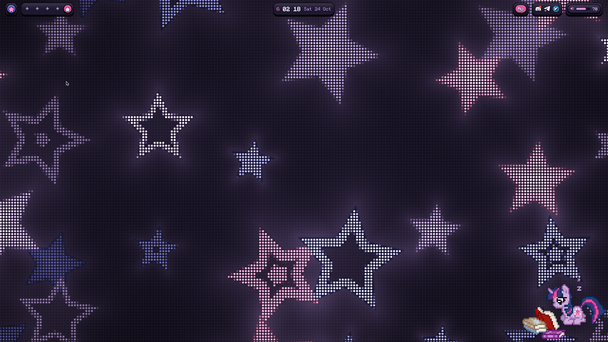
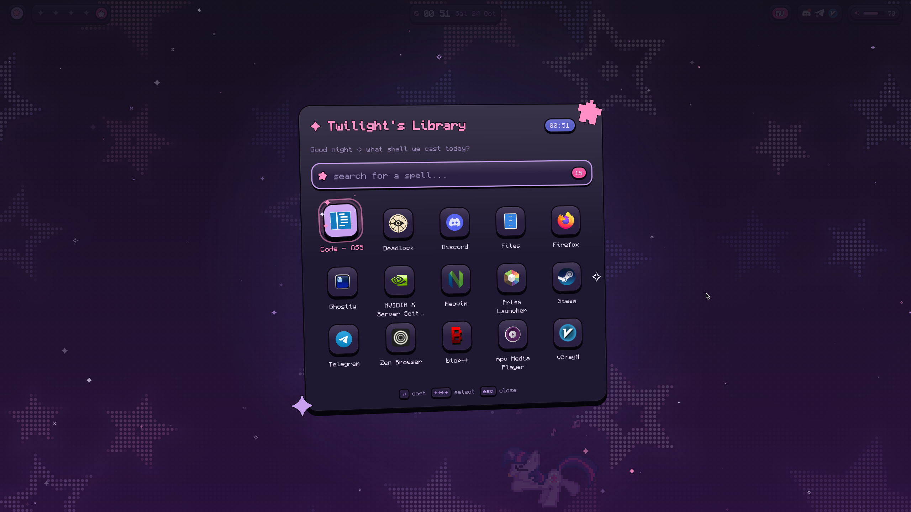
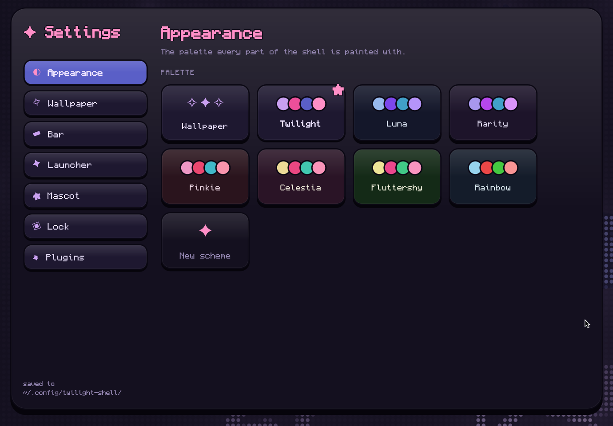
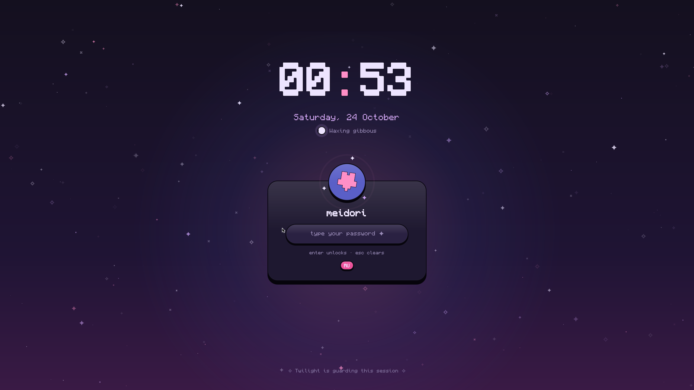

# dotfiles

My setup for [Void Linux](https://voidlinux.org): the [niri](https://github.com/YaLTeR/niri)
compositor with the [twilight-shell](https://github.com/twilight-shell/shell) desktop shell,
plus ghostty, fish and starship.



| Launcher | Bar |
| --- | --- |
|  |  |

| Settings | Lock screen |
| --- | --- |
|  |  |

## Why the odd directory layout

The repo isn't a copy of `~/.config`. Every top-level directory is a
[GNU Stow](https://www.gnu.org/software/stow/) *package*, and inside it the files sit at the
path they should have relative to `$HOME`:

```
niri/.config/niri/config.kdl      ->  ~/.config/niri/config.kdl
scripts/.local/bin/screen-record  ->  ~/.local/bin/screen-record
```

`stow niri` makes symlinks from `$HOME` into the repo, so editing a file in `~/.config`
edits the repo directly. This way:

- you can install only what you want (`stow niri ghostty`, skip the rest);
- nothing else from `~` (secrets, caches, other apps' configs) can end up in the repo;
- removing a package is clean: `stow -D niri`.

Not everything fits: `system/` holds files for `/etc`, which stow can't manage
(see [system/README.md](system/README.md)), and `packages.txt` / `fonts.sh` are
helpers, not packages.

## Layout

| Directory | Goes to | What |
| --- | --- | --- |
| `niri/` | `~/.config/niri` | compositor config, keybinds, startup |
| `twilight-shell/` | `~/.config/twilight-shell` | bar, launcher, lock, theme, wallpaper (TOML) |
| `ghostty/` | `~/.config/ghostty` | terminal |
| `fish/` | `~/.config/fish` | shell |
| `starship/` | `~/.config/starship.toml` | prompt |
| `gtk/` | `~/.config/gtk-{3,4}.0` | GTK settings |
| `scripts/` | `~/.local/bin` | `screen-record` (toggle recording with `Mod+Alt+R`) |
| `system/` | `/etc` | copied manually as root |

## Installing

```sh
git clone https://github.com/Meidorislav/dotfiles ~/dotfiles
cd ~/dotfiles

# 1. packages (Void)
sudo xbps-install -S $(cat packages.txt)

# 2. fonts missing from the repos (Monocraft)
./fonts.sh

# 3. symlink the configs
stow niri twilight-shell ghostty fish starship gtk scripts
```

If stow complains that a target already exists, move your old file away first
(`mv ~/.config/niri ~/.config/niri.bak`) and run it again.

Then install [twilight-shell](https://github.com/twilight-shell/shell) itself, which is not a
package in Void. Clone it anywhere:

```sh
git clone --recurse-submodules https://github.com/twilight-shell/shell.git ~/src/twilight-shell
cd ~/src/twilight-shell
sudo make install    # modules to /usr/lib/qt6/qml, `twilight-shell` to /usr/bin
```

The niri config calls plain `twilight-shell`, so it has to be in `PATH`.

Optionally, the NVIDIA tweak from [system/README.md](system/README.md), then log in to niri.

## Keybinds

`Mod` is Super.

| Key | Action |
| --- | --- |
| `Mod+Return` | terminal (ghostty) |
| `Mod+P` | launcher |
| `Mod+S` | settings |
| `Mod+E` | files (nautilus) |
| `Mod+Alt+R` | start/stop screen recording → `~/Videos` |
| `Mod+Alt+Shift+L` | lock screen |
| `Mod+Shift+/` | full list (niri hotkey overlay) |

Layouts: `us,ru`, switched with Caps Lock.

## Changing things

Edit files in the repo (or through the symlinks, it's the same). The twilight-shell TOML files
apply the moment they are saved; niri reloads its config on its own.
To add a new config: create `name/.config/name/...`, then `stow name`.
